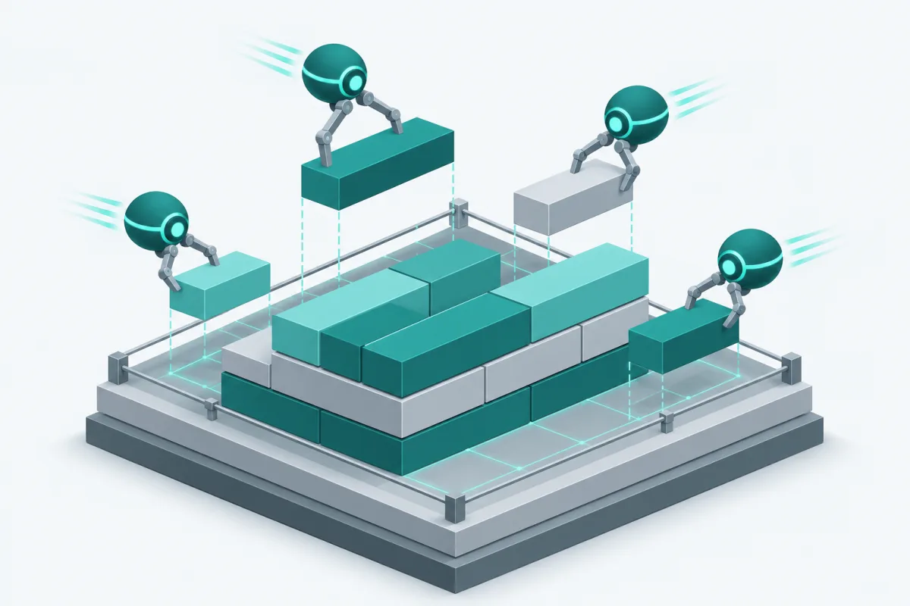
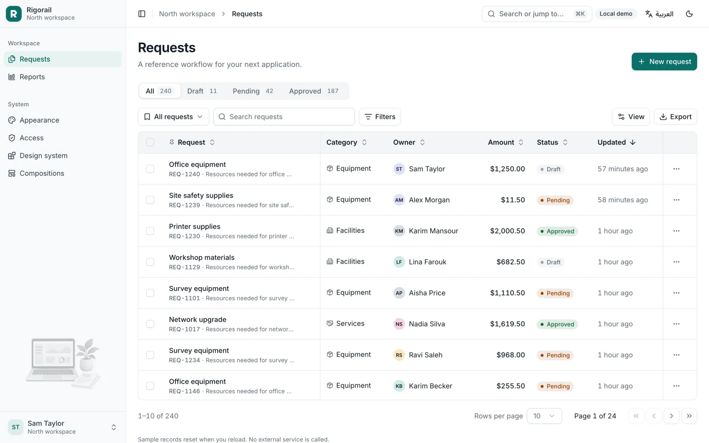
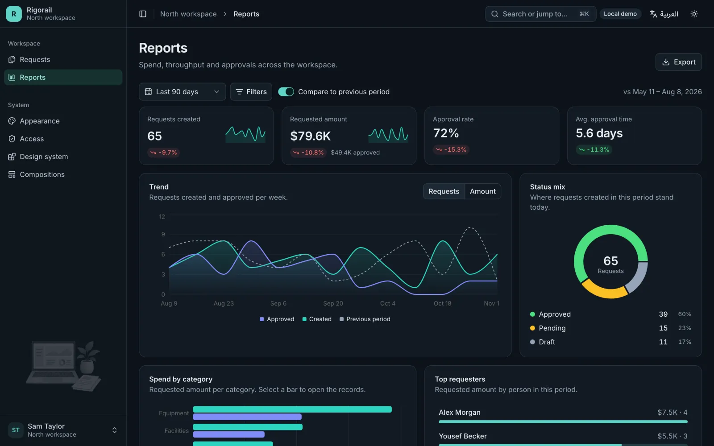
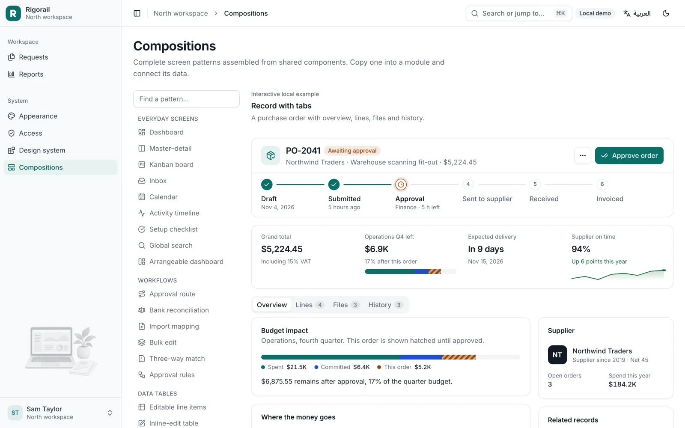
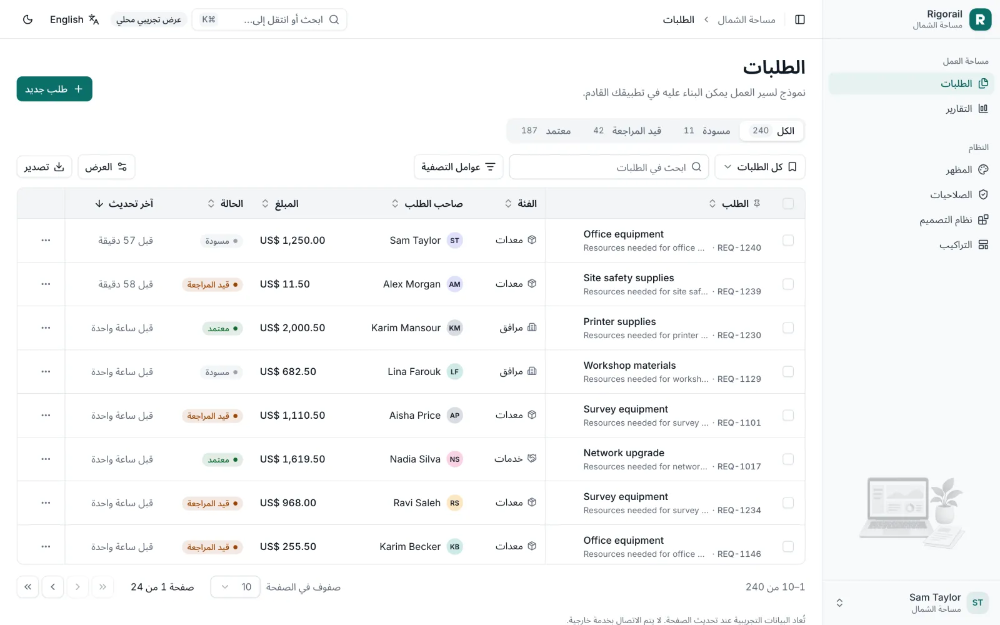
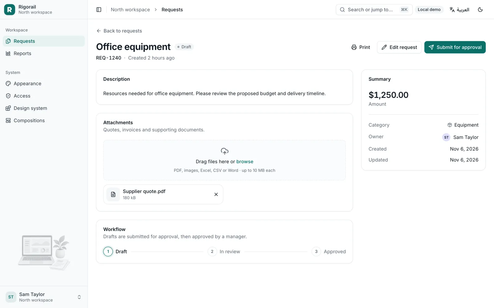
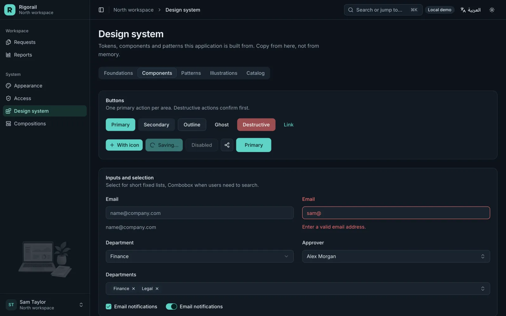
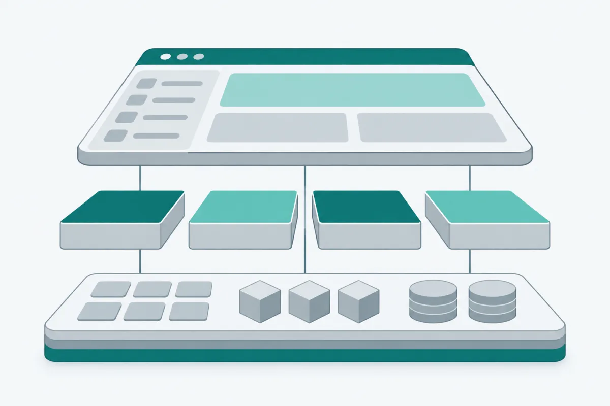
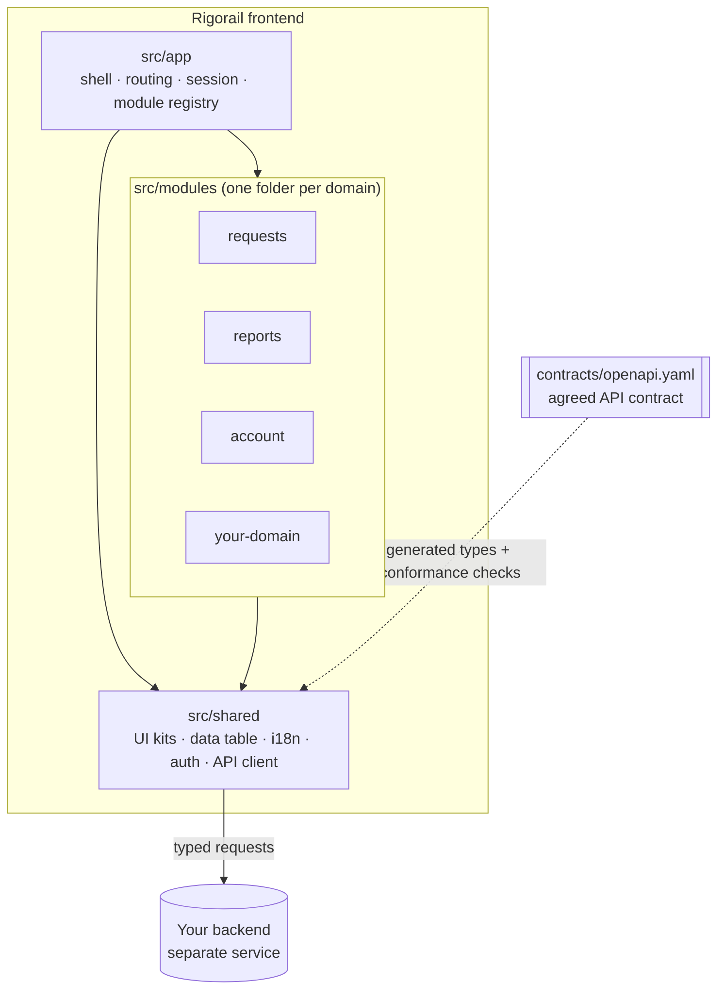
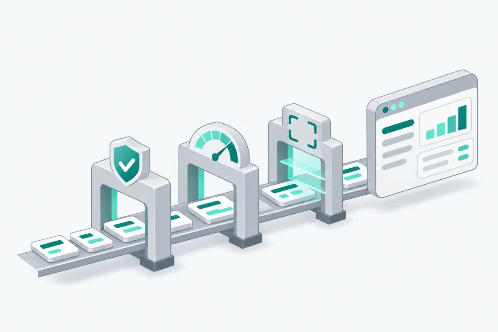

<div align="center">



<h1>&nbsp;Rigorail</h1>

### Vibe coding. Engineered frontends.

**We engineered your vibe coding.** Rigorail is a React frontend template that makes
AI coding agents work like real frontend engineers: clear architecture, proven
patterns and automated checks, so your app stays clean instead of turning into AI
spaghetti slop as it grows.

[](https://github.com/ahmedtolan2019/rigorail/actions/workflows/ci.yml)
[](LICENSE)


[Quick start](#quick-start) ·
[Features](#features) ·
[Architecture](#architecture) ·
[Prompts for your agent](#prompts-for-your-agent) ·
[Docs](#documentation)

</div>

---

## Why Rigorail

Vibe coding makes it easy to get a screen working. The trouble starts later: every
prompt adds another one-off component, another copy of the same fetch logic, another
skipped error state. A few hundred prompts in, the codebase is AI spaghetti slop
that neither you nor your agent can safely change.

Real frontend engineers prevent that with module boundaries, agreed API contracts,
shared patterns, permission and failure states, accessible markup, localization and
tests. Agents skip all of it when nothing asks for it.

Rigorail puts that engineering into the starting point, so your agents work like
real frontend engineers from the first prompt to the thousandth. They get focused
instructions, a working reference for every common screen, and checks that fail when
they cut corners. You keep the speed of vibe coding; the frontend stays engineered
in the long run.

- **Frontend only.** Your backend stays a separate service behind an agreed contract.
- **Agent ready.** One `AGENTS.md` entry point for Claude Code, Codex, Gemini,
  Copilot and any agent that reads it.
- **Verified, not promised.** Lint, types, architecture boundaries, API contract
  conformance, bundle budget, unit, browser and accessibility tests run in CI.

## Quick start

```sh
npm create rigorail@latest my-app
cd my-app
npm install
npm run dev
```

Open http://localhost:5173. The demo runs on local sample data, so no backend, API
key or account is needed. Prefer GitHub? Use **Use this template** on the repository
page, then run `npm ci && npm run dev`.

Requirements: Node 24 (see `.nvmrc`) and npm 11.

> [!TIP]
> Using a coding agent? Paste the [setup prompt](#1-set-up-the-project) and let it
> install, verify and explain the project for you.

## Features

<table>
<tr>
<td width="50%"></td>
<td width="50%"></td>
</tr>
<tr>
<td><b>Data screens that scale.</b> Server pagination, filters with facet counts, saved views, column pinning and grouping, cross-page bulk actions, and Excel/CSV export.</td>
<td><b>Reports and dark mode.</b> Date ranges with comparison, KPI cards, charts and drill-down, all themed by design tokens.</td>
</tr>
<tr>
<td></td>
<td></td>
</tr>
<tr>
<td><b>40+ screen compositions.</b> Record pages, approval chains, reconciliation, import mapping, kanban, calendar, audit log, report builder and more, ready to adapt.</td>
<td><b>Localization with RTL support.</b> Every screen ships in two locales, including a right-to-left layout, with locale-aware dates, numbers and currency.</td>
</tr>
<tr>
<td></td>
<td></td>
</tr>
<tr>
<td><b>Complete detail and form flows.</b> Permission-aware actions, confirmations, attachments with upload progress, optimistic concurrency, leave guards and print layouts.</td>
<td><b>A living design system.</b> Tokens, components and application kits with the source path to import, plus a generated component catalog.</td>
</tr>
</table>

### What's inside

| Area | Included |
| --- | --- |
| **Shell** | Sidebar or top navigation, ⌘K command palette, `?` shortcut help, breadcrumbs, toasts, route progress, light, dark and system themes, two densities |
| **Data** | TanStack Query and Router, server data table, saved views, export, reports, live updates (Server-Sent Events) |
| **Forms and records** | React Hook Form + Zod, field components, confirmations, uploads, print mode, concurrency and leave guards |
| **Account** | Sign-in with two-step verification, password recovery, SSO entry, account page, session expiry and cross-tab sign-out |
| **Access** | Permission vocabulary per module, record-level checks, feature flags, plans and quotas |
| **Localization** | i18n with typed keys and plural forms, RTL support, organization time zones |
| **Platform** | OpenAPI contract with generated types, error reporting, analytics and Web Vitals hooks, stale-deploy recovery, CSRF and request-ID headers |
| **Agents** | `AGENTS.md`, focused `npm run context`, screen recipes, composition authoring guide, module scaffolding |
| **Quality** | Architecture audit, contract conformance, catalog check, bundle budget, Vitest, Playwright on Chromium, Firefox and WebKit, axe accessibility audits |

## Architecture



Rigorail is a single-page app with three layers and one rule: dependencies point
down, and modules talk only through public contracts. The architecture audit
enforces it on every check.

- **`src/app`** composes the shell, routes, session and module registry.
- **`src/modules/<domain>`** owns a business area: routes, screens, schemas,
  queries, permissions and strings. Other code imports only its `public.ts`.
- **`src/shared`** holds domain-neutral UI, kits and services.

<br clear="right" />



Read more in [architecture](docs/architecture.md) and the
[backend contract](docs/backend-contract.md).

## Engineering guardrails



Guidance tells agents what good looks like; checks make it stick. `npm run check`
runs all of these, and CI runs them on every pull request.

| Check | Catches |
| --- | --- |
| Architecture audit | Imports across module boundaries, unknown layers, cycles |
| API contract conformance | Schemas that drift from `contracts/openapi.yaml` |
| Types and lint | Unsafe code and unused or invalid patterns |
| Catalog and bundle budget | Undocumented components and bundle bloat |
| Unit and browser tests | Broken behavior across real user flows |
| Accessibility audits | WCAG 2.2 AA failures in light and dark, desktop and mobile |

<br clear="right" />

## Prompts for your agent

Copy a prompt into Claude Code, Codex, Cursor, Copilot or any coding agent. Each one
points the agent at the right files and ends with verification, the way real
engineers would.

### 1. Set up the project

```text
Set up a new frontend project from the Rigorail template.

1. Run `npm create rigorail@latest <app-name>` and open the new folder.
   If that is not available, clone https://github.com/ahmedtolan2019/rigorail.
2. Use the Node version in .nvmrc, then run `npm install` and
   `npx playwright install chromium`.
3. Run `npm run check` and report the results honestly.
4. Start `npm run dev`, open http://localhost:5173 and confirm the demo loads.
5. Read AGENTS.md, then summarize the architecture, the commands I will use daily,
   and which docs you will follow for new screens. Do not change code yet.
```

### 2. Make it yours

```text
Turn this Rigorail project into <product name>.
Read AGENTS.md and docs/customization-and-ux.md first.
- Set the name, default currency, locales and brand colors (src/app/config.ts,
  src/index.css tokens, index.html, public/theme-init.js storage keys).
- Run `npm run module:remove -- compositions --dry-run` and the same for the other
  reference modules, then tell me what removing each would affect. Remove only the
  ones I approve.
Finish with `npm run check` and a screenshot review of the shell in light and dark.
```

### 3. Connect your backend

```text
Connect this app to our API. The OpenAPI spec is at <path or URL>.
Follow docs/backend-contract.md.
1. Replace contracts/openapi.yaml with our spec and run `npm run api:types`.
2. Update module schemas so contract.check.ts files pass, without weakening them.
3. Configure VITE_APP_MODE=api and VITE_API_BASE_URL in .env.local (no secrets).
4. Agree session, CSRF and CORS settings in src/app/config.ts with me first.
Run `npm run check` and list every endpoint the frontend now depends on.
```

### 4. Build a new domain module

```text
Build a <domain> module (for example "purchase-orders") for <users and goal>.
Read docs/screen-recipes.md, then:
1. Run `npm run module:create -- <domain>`.
2. Add the API to contracts/openapi.yaml, run `npm run api:types`, and write the
   schemas, queries and contract.check.ts.
3. Build the list, detail and create/edit screens with the screen recipes,
   copying from the Requests reference.
4. Cover loading, empty, error and permission states, localization with RTL
   support, and dark mode.
5. Add browser tests for the main flow and add the screens to the accessibility spec.
Run `npm run check` and the relevant Playwright tests before you finish.
```

### 5. Build a screen from a composition

```text
I need a screen where <who> can <decision or task>.
Read docs/pattern-coverage.md and pick the closest compositions, then
`npm run context -- compositions <view>` for each. Explain your choice first.
Adapt it into the owning module (never import from compositions), wire it to
queries in queries.ts, and meet the quality bar in docs/composition-authoring.md.
Review screenshots at 375, 1000 and 1280px, in RTL and dark mode, then run checks.
```

### 6. Review before merging

```text
Review the current changes like a senior frontend engineer.
Check module boundaries, API calls only in queries.ts, permission and failure
states, no internal ids on screen, localization with RTL support, keyboard access,
and tests. Run `npm run check` and the affected Playwright specs. Report findings
by severity with file and line, then fix the ones I approve.
```

### 7. Prepare for production

```text
Prepare this app for production using docs/deployment.md.
Verify the build with the production environment variables, list the security
headers and CSP our host needs (including our API and upload storage hosts), wire
our error and analytics services in src/main.tsx, and walk me through the release
checklist. Do not deploy.
```

More task prompts: [ai/example-prompts.md](ai/example-prompts.md).

## Project structure

```text
contracts/openapi.yaml     Agreed API contract (source of generated types)
docs/                      Architecture, recipes, contracts, deployment, catalog
src/app/                   Shell, routing, session, module registry, demo backend
src/modules/<domain>/      Business modules with AGENTS.md, contract.md, public.ts
src/shared/                UI, data table, export, uploads, i18n, auth, API client
tests/e2e/                 Playwright flows and accessibility audits
scripts/                   Architecture audit, catalog, scaffolding, API types
packages/create-rigorail/  The `npm create rigorail` initializer
```

## Scripts

| Command | Purpose |
| --- | --- |
| `npm run dev` | Start the app with demo data at http://localhost:5173 |
| `npm run check:fast` | Lint, architecture, catalog, API types and typecheck while editing |
| `npm run check` | Full gate: everything above plus unit tests, builds and bundle budget |
| `npm run test:e2e` | Browser flows and accessibility audits (`E2E_ALL_BROWSERS=1` adds Firefox and WebKit) |
| `npm run context -- <module>` | Print one module's contract, source map and focused checks |
| `npm run module:create -- <id>` | Scaffold a checked domain module with a browser test |
| `npm run module:remove -- <id>` | Remove a module and report remaining references |
| `npm run api:types` | Regenerate types from `contracts/openapi.yaml` |
| `npm run build` | Production build for your API (`VITE_APP_MODE=api`) |

## Demo accounts

The demo starts signed in. To try the sign-in screens, sign out from the account
menu and use any email with password `demo-password-1`. Add `+mfa` to the email for
the two-step code `123456`. These exist only in the local demo backend.

## Documentation

| Topic | Read |
| --- | --- |
| Start here for agents | [AGENTS.md](AGENTS.md) |
| Building list, detail, form, dashboard and settings screens | [Screen recipes](docs/screen-recipes.md) |
| Composing and creating screens, quality bar | [Composition authoring](docs/composition-authoring.md), [pattern coverage](docs/pattern-coverage.md) |
| Layers, state ownership, decisions | [Architecture](docs/architecture.md) |
| API, session, uploads, live updates | [Backend contract](docs/backend-contract.md) |
| Branding, layout and localization | [Customization and UX](docs/customization-and-ux.md) |
| Permissions | [Access control](docs/access-control.md) |
| Loading and failures | [Error handling](docs/error-handling.md) |
| Components and kits | [Component catalog](docs/component-catalog.md) |
| Hosting and release | [Deployment](docs/deployment.md) |

## Contributing

Issues and pull requests are welcome. Read [CONTRIBUTING.md](CONTRIBUTING.md) and the
[code of conduct](CODE_OF_CONDUCT.md); report vulnerabilities privately as described
in [SECURITY.md](SECURITY.md).

## License and credits

Rigorail is designed and engineered by **Ahmed Tolan** and released under the
[MIT License](LICENSE). The project grew from the idea of
[kston83/react-ai-template](https://github.com/kston83/react-ai-template);
[third-party notices](THIRD_PARTY_NOTICES.md) credit it and the bundled agent
skills.
